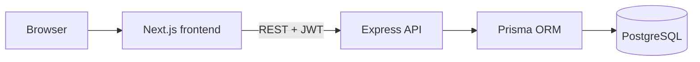
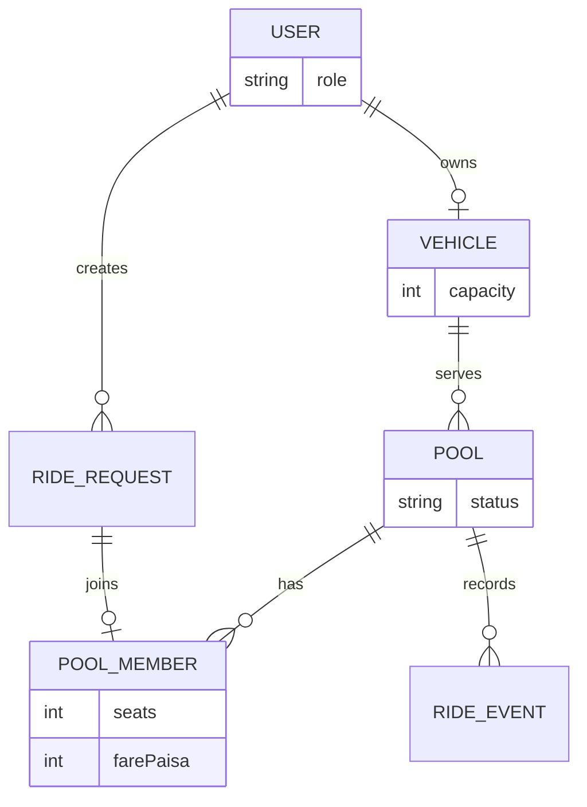

# Dhaka Tesla Pool

> Share a seat. Split the fare. Survive Dhaka traffic.

A full-stack MVP for pooling compatible Dhaka trips. It handles passenger requests, safe vehicle capacity, clear ride states, individually calculated pooled fares, and a driver workflow.

## Demo accounts

All seeded accounts use password `Tesla123!`.

| Person | Role | Email |
| --- | --- | --- |
| Nusrat | Passenger | `nusrat@dhakatesla.test` |
| Rafiq | Passenger | `rafiq@dhakatesla.test` |
| Shirin | Passenger | `shirin@dhakatesla.test` |
| Jashim | Driver | `jashim@dhakatesla.test` |

## Architecture



## Data model



## Key decisions

- **Next.js + TypeScript** creates a simple, typed passenger and driver interface.
- **Express + TypeScript** keeps the API small, explicit, and easy to defend in an interview.
- **PostgreSQL + Prisma** fit the relational ride/pool model. Ride joins use a transaction with a row lock so the final seat cannot be oversold.
- Money is stored as integer **paisa**, avoiding floating-point rounding errors.
- A request matches a pool when it has the same pickup zone and the pool is still `MATCHED`. The destination may differ; Banani → Mohakhali and Banani → Gulshan are deliberately compatible in the demo.

## Fare model

`fare = baseFare + (distanceKm × ratePerKm) − poolDiscount`

The seeded Nusrat (5 km) and Rafiq (4 km) trips both have a ৳30 pool discount: Nusrat = ৳120 and Rafiq = ৳100. Values are stored in paisa.

## Run locally

```bash
cp .env.example .env
docker compose up --build
```

Open `http://localhost:3000`. The API runs on port `4000`; its health endpoint is `/health`.

For local development, start PostgreSQL with Docker, then run `npm install` in both `backend` and `frontend`; use `npm run db:migrate && npm run db:seed && npm run dev` in the backend and `npm run dev` in the frontend.

## Tests

```bash
cd backend
npm test
```

The tests cover fare calculations, lifecycle validation, and capacity rules. The production join path uses `SELECT ... FOR UPDATE` within a PostgreSQL transaction; at larger scale, keep this invariant in the database and add idempotency keys plus an outbox/queue for notifications.

## Important API routes

- `POST /api/auth/register`, `POST /api/auth/login`
- `GET /api/pools`, `POST /api/rides`, `POST /api/rides/:id/cancel`
- `POST /api/pools/:id/accept`, `/arrive`, `/start`, `/complete`
- `GET /api/driver/pools`, `PATCH /api/driver/availability`

## Limitations and next steps

This MVP uses zone-based matching, mocked distance data, no real payments, and HTTP polling. A production version would introduce real routing/geospatial matching, live updates, payment reconciliation, rate limiting, and audit/observability tooling.

## AI usage

AI assistance (Codex) was used to scaffold the project, discuss schema/API options, and draft tests and documentation. I accepted the suggestion to store money in integer paisa and enforce capacity in a transaction. I changed the suggested “match exact route” rule to same-pickup-zone matching because it better demonstrates the Nusrat/Rafiq shared journey described in the brief. Every generated part should be reviewed, understood, and adjusted by the applicant before submission.

## Submission notes

Create `master`, `pre-release`, `release/v1.0.0`, and real `feature/*` branches while building. Record the requested six-minute video and place its link here before submitting.
